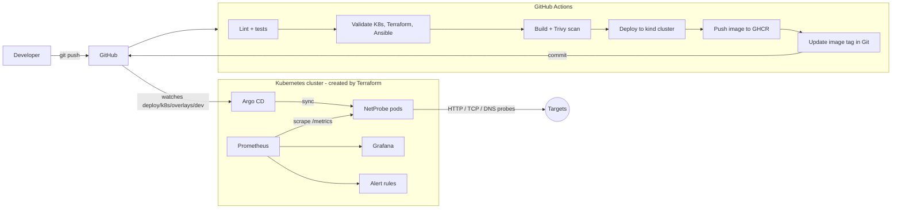

# NetProbe

[](https://github.com/RachidAifar/netprobe/actions/workflows/ci.yml)

A small **network uptime probe** and the complete **DevOps platform** around it: containers, CI/CD, Kubernetes, **GitOps with Argo CD**, **Infrastructure as Code** with Terraform and Ansible, and **monitoring** with Prometheus, Grafana and the ELK stack.

NetProbe checks HTTP endpoints, TCP ports and DNS names on a schedule, and exposes the results as Prometheus metrics and JSON logs.

## Architecture



**GitOps flow:** every push to `main` that passes all checks builds a new image, pushes it to GitHub Container Registry, and commits the new image tag into `deploy/k8s/overlays/dev`. Argo CD sees the commit and rolls it out. Git is the single source of truth: no one runs `kubectl apply` by hand.

## What's in the repository

| Path | What it is | Skills it shows |
|---|---|---|
| `app/` | Python service (FastAPI, asyncio): HTTP, TCP and DNS probes, `/metrics`, `/health`, `/ready`, JSON logs | Python, networking, observability |
| `app/tests/` | 26 pytest tests, 90% coverage, using a real local TCP server and mocked HTTP | Testing |
| `Dockerfile` | Multi-stage build, non-root user, health check | Containers, security |
| `compose.yaml` | NetProbe + Prometheus + Grafana with provisioned dashboard | Monitoring |
| `compose.elk.yaml` | Filebeat → Elasticsearch → Kibana for the JSON logs | ELK |
| `monitoring/` | Prometheus scrape config, alert rules, Grafana dashboard | Monitoring, alerting |
| `deploy/k8s/` | Kustomize base + dev/prod overlays: Deployment with probes and security context, Service, PDB, NetworkPolicy, HPA, ServiceMonitor, PrometheusRule | Kubernetes |
| `deploy/argocd/` | Argo CD Application with automated sync, prune and self-heal | GitOps |
| `infra/terraform/` | kind cluster + Argo CD + kube-prometheus-stack + the NetProbe Application | Terraform, Helm |
| `infra/ansible/` | Playbook that installs Docker, kubectl, kind and Terraform on Ubuntu; idempotent | Ansible, Linux |
| `.github/workflows/ci.yml` | Lint, test, validate, scan, deploy to kind, publish, GitOps update | CI/CD |
| `docs/RUNBOOK.md` | What to do when each alert fires | Operations |

## Run it

### 1. Docker Compose (5 minutes)

Needs Docker.

```bash
docker compose up -d --build
```

| Service | URL |
|---|---|
| NetProbe status | http://localhost:8080/targets |
| NetProbe metrics | http://localhost:8080/metrics |
| Prometheus (alerts) | http://localhost:9090/alerts |
| Grafana dashboard | http://localhost:3000 → Dashboards → NetProbe |

Change the targets in `app/config/targets.yaml` and run `docker compose up -d --build` again. Try adding a target that does not exist and watch the **TargetDown** alert move from *pending* to *firing* after 2 minutes.

Logs in Kibana (needs about 2 GB of free memory):

```bash
docker compose -f compose.yaml -f compose.elk.yaml up -d --build
# Kibana: http://localhost:5601 → Discover → create a data view for "netprobe-*"
```

### 2. Kubernetes with GitOps (15 minutes)

Needs Docker, Terraform and kubectl. On a fresh Ubuntu machine, Ansible installs them:

```bash
cd infra/ansible && ansible-playbook bootstrap.yml --ask-become-pass
```

Then create the cluster with Argo CD and monitoring:

```bash
cd infra/terraform
terraform init
terraform apply
terraform output next_steps     # port-forward commands and passwords
```

Argo CD deploys NetProbe from this repository. To see GitOps in action, change `replicas` in `deploy/k8s/overlays/dev/kustomization.yaml`, push, and watch Argo CD scale the deployment.

> The image on GHCR must be public for the cluster to pull it: GitHub → your profile → Packages → netprobe → Package settings → Change visibility.

### 3. Develop and test

```bash
make install    # virtualenv with the app and linters
make test       # pytest with coverage
make lint       # ruff, yamllint, ansible-lint
make validate   # kubeconform + terraform validate
```

## The CI/CD pipeline

| Job | What it checks |
|---|---|
| Lint and unit tests | `ruff`, `pytest`, coverage must stay above 85% |
| Validate infrastructure code | `yamllint`, `ansible-lint` (production profile), `kubeconform` on every overlay, `promtool` on alert rules, `terraform fmt` + `validate` |
| Ansible playbook | Runs the playbook on the runner **twice**; the second run must report `changed=0` |
| Build, scan and smoke-test | Docker build, start the container, check `/health` and `/metrics`, check it runs as non-root, **Trivy** scan for critical and high vulnerabilities |
| Deploy to a kind cluster | Real Kubernetes cluster in CI: deploy the dev overlay, wait for rollout, call the service from another pod |
| Publish (main only) | Push the image to GHCR, then commit the new tag to the dev overlay for Argo CD |

## Design decisions

- **Probes never raise.** Each probe returns a result with `up`, `duration` and a `detail` string (`HTTP 503`, `timeout`, `Connection refused`), so one bad target cannot stop the others. Probes run concurrently with `asyncio.gather`.
- **Liveness vs readiness.** `/health` only says the process is alive. `/ready` returns 503 until the first probe round finishes, so Kubernetes does not send traffic to a pod with no data yet.
- **Least privilege.** Non-root user, read-only root filesystem, all Linux capabilities dropped, no service account token, and a NetworkPolicy that only lets Prometheus and the namespace reach the pod.
- **No downtime on deploy.** `maxUnavailable: 0`, readiness probes and a PodDisruptionBudget.
- **Same alerts everywhere.** The rules in `monitoring/prometheus/alerts.yml` are used by Docker Compose and, as a `PrometheusRule`, in Kubernetes; `promtool` checks them in CI. Each alert links to a section in the [runbook](docs/RUNBOOK.md).

## License

MIT. Developed with Claude Code as a pair-programming assistant.
